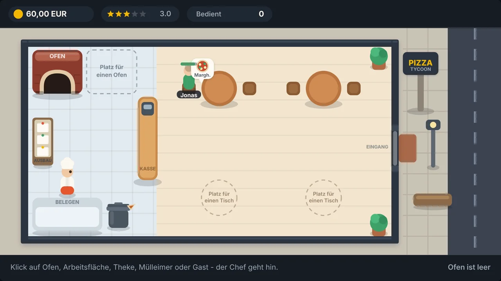

# Pizzeria Tycoon

Ein kleines Wirtschaftsspiel im Browser: Du führst eine Pizzeria ganz allein.
Gäste kommen von der Straße herein, setzen sich und bestellen. Du belegst die
Pizza, backst sie im Ofen und servierst sie im richtigen Moment.



Der ganze Laden ist immer als **ein Bild** zu sehen – nichts zoomt, nichts läuft
mit. Geschrieben ist alles von Hand in HTML, CSS und JavaScript auf einem
einzigen Canvas: keine Bibliothek, keine Bilddatei, kein Build-Schritt.

---

## Spielen

Doppelklick auf `index.html` – das Spiel braucht keinen Server und keine
Installation. Es läuft genauso online und auf dem Handy; Maus und Finger werden
gleich behandelt.

Beim ersten Start erklärt eine **Anleitung in sieben Schritten**, was man wo
macht. Sie dunkelt den Laden ab und zeigt jeweils genau die Stelle, um die es
geht. Überspringen geht auf jeder Karte, und das Fragezeichen in der Kopfzeile
holt sie jederzeit zurück.

---

## So läuft eine Runde

```
Gast kommt ──► bestellt ──► Arbeitsfläche ──► Ofen ──► servieren ──► Kasse
    ▲              (Geduld sinkt)        (Backbalken)     (Sterne, Geld)   │
    └──────────── besserer Ruf holt mehr Gäste ◄─────────────────────────┘
```

Der Druck entsteht aus drei Dingen zugleich: Die **Backzeit** läuft, die
**Geduld** der Gäste sinkt, und der **Chef muss jeden Weg selbst gehen**.

1. Ein Gast kommt herein und setzt sich an einen freien Tisch. Ist keiner frei,
   geht er wieder.
2. Er bestellt, über dem Kopf sinkt sein Geduldsbalken.
3. Du belegst die Pizza an der Arbeitsfläche. Dort können mehrere nebeneinander
   liegen – so arbeitest du vor.
4. Du schiebst sie in den Ofen und holst sie zum richtigen Zeitpunkt heraus.
5. Du servierst. Der Gast isst, zahlt an der Kasse und gibt Sterne.
6. Aus den Sternen wird der Ruf, und der Ruf bestimmt, wie viele Gäste kommen.

---

## Steuerung

| Eingabe | Was passiert |
| --- | --- |
| Klick oder Tipp auf eine Station | Auswahlfenster geht auf, der Chef läuft hin und macht es |
| Klick auf einen Gast | zeigt seinen Wunsch und das Servieren – die ganze Figur ist anklickbar |
| Klick auf eine freie Stelle | der Chef geht einfach dorthin |
| WASD oder Pfeiltasten | selbst laufen (übernimmt und wirft die Aufgabenliste weg) |
| E oder Leertaste | an der nächsten Station handeln |
| Fragezeichen oben | Anleitung wieder öffnen |

Die Auswahlfenster sind **Bild-Kacheln, keine Textlisten**: Jede Kachel zeigt die
Sache selbst, ein kleines Zeichen in der Ecke sagt, was passiert – Plus für neu
belegen, Pfeil hoch für nehmen, runter für ablegen, rechts für servieren. Das
Fenster bleibt offen und baut sich laufend neu auf, die Kachel wandert also
während des Backens von „roh“ über „gut“ zu „perfekt“, ohne dass man erneut
klickt.

Ist der Chef schon unterwegs, **macht er seinen Schritt fertig** und der neue
Klick reiht sich dahinter ein – bis zu drei. Ein Zähler über dem Kopf zeigt, was
noch ansteht.

---

## Ofen und Karte

Der Ofen läuft immer, einen Schalter gibt es nicht; das Feuer brennt nur,
solange eine Pizza drin liegt. Die Leiste auf dem Ofen braucht **elf Sekunden**,
zwei Marken zeigen, wo „perfekt“ anfängt und wo es kippt.

| Backstand | Ergebnis |
| --- | --- |
| unter 0,60 | roh |
| bis 0,85 | gut |
| bis 1,05 | perfekt |
| danach | verbrannt |

Eine zu früh herausgeholte Pizza darf zurück in den Ofen. Was misslungen ist,
kommt in die Tonne neben der Arbeitsfläche.

| Pizza | Verkauf | Zutaten | Gewinn |
| --- | --- | --- | --- |
| Margherita | 8,50 € | 2,50 € | 6,00 € |
| Salami | 10,00 € | 3,20 € | 6,80 € |
| Funghi | 9,50 € | 3,00 € | 6,50 € |

**Zutaten sind immer da** – es gibt keinen Vorrat und keine Frische. Bezahlt wird
aber schon beim Belegen, nicht erst beim Verkauf: Eine verbrannte oder falsch
belegte Pizza ist dadurch ein echter Verlust.

---

## Bewertung, Ruf und Ausbau

Jeder Gast vergibt ein bis fünf Sterne, ausgehend von fünf. Abzug gibt es für
langes Warten, für eine nur „gute“ statt perfekte Pizza, für roh, verbrannt oder
die falsche Sorte. Ab vier Sternen gibt es Trinkgeld. Der **Ruf** ist der Schnitt
der letzten 20 Bewertungen und bestimmt zusammen mit der Tischzahl, wie schnell
der nächste Gast hereinkommt.

Gekauft wird an der Bautafel in der Küche:

| Ausbau | Preis | Was es bringt |
| --- | --- | --- |
| Größere Arbeitsfläche | 40 € | vier belegte Pizzen statt drei |
| Dritter Tisch | 60 € | zwei Plätze mehr |
| Vierter Tisch | 90 € | nochmal zwei Plätze |
| Besserer Ofen | 120 € | „perfekt“ gelingt leichter, verbrennt später |
| Zweiter Ofen | 200 € | zwei Pizzen gleichzeitig backen |

Mit einem Ofen und vollem Gastraum kommt man ins Schwitzen – ab da lohnt der
zweite.

---

## Aufbau

Es gibt keine ES-Module: Alle Skripte hängen als normale `<script src>` in fester
Reihenfolge in der `index.html`, `main.js` zuletzt. Alles liegt im Namensraum
`PT`.

| Datei | Wofür |
| --- | --- |
| `js/config.js` | alle Zahlen und Farben an einer Stelle |
| `js/gfx.js` | Leinwand und Zeichenhelfer (960 × 540 logische Einheiten) |
| `js/input.js` | Maus, Finger und Tastatur |
| `js/nav.js` | Wegfindung über ein unsichtbares Raster |
| `js/shop.js` | der Grundriss und alles Unbewegliche |
| `js/chef.js` | der Chef |
| `js/oven.js` | Öfen, Arbeitsfläche, Backzeit |
| `js/customers.js` | Gäste, Geduld, Bewertung, Theke |
| `js/economy.js` | Kasse |
| `js/upgrades.js` | Ausbauten |
| `js/ui.js` | Kopfzeile, Fußzeile, Meldungen, Auswahlfenster |
| `js/tutorial.js` | die Anleitung beim Start |
| `js/main.js` | Spielschleife, Klicks und die Aktionen an den Stationen |

Gezeichnet wird immer in 960 × 540 logischen Einheiten; die Leinwand ist so groß
wie das Fenster mal Pixeldichte, eine Transformation rechnet um. Dadurch ist
alles bei jeder Fenstergröße scharf, auch die Schrift, und der Laden passt immer
ganz ins Bild.

**Zum Balancen reicht `js/config.js`** – Preise, Backzeit, Geduld, Spawnraten,
Ausbauten und die Farbpalette stehen dort gesammelt.

Wie das Spiel gedacht ist und warum es bestimmte Dinge bewusst **nicht** hat
(keinen Garten, kein Holz, keine Kamera, keinen Tageslauf), steht ausführlich in
[`PLAN.md`](PLAN.md).
